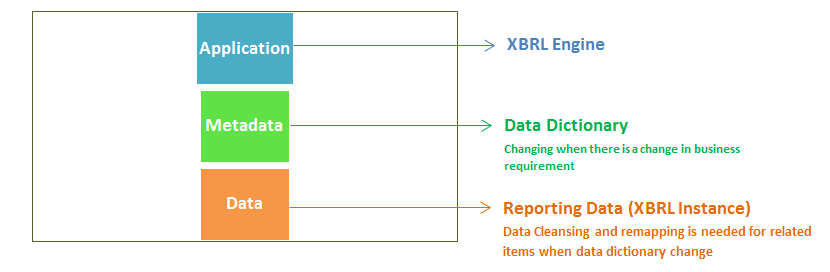

*Originally published on September 9, 2013 at geexbrl.wordpress.com.*

XBRL (Extensible Business Reporting Language) is a reporting language, especially for financial reporting. XBRL has been used in some country, such as japan, australia, china, and europe. In Indonesia, XBRL brought by Bank Indonesia (Central Bank of Indonesia) with LBUS (General Syariah Bank Report) project. LBUS is pilot project of LSMK (Stability of Monetary and Financial System Report), an integration of almost 11 financial reports from financial institutions to Bank Indonesia as Central Bank.

XBRL is promising an easy way on exchanging data. XBRL introduce a data dictionary concept, which acts as “metadata” of reports. In this data dictionary is included report scheme, data type, rule, and validation. This method increase the flexibility of report, because changing is not apply in application level anymore. Application is become more general, all we need is an XBRL Engine (mapper, viewer, and validator) which provide the same XML and XBRL specification as data dictionary.

Beside Bank Indonesia, XBRL is also used by Indonesian Stock Exchange (on Public Review State) and SKK Migas (on Prove of Concept State).

-by Sri Handika Utami
