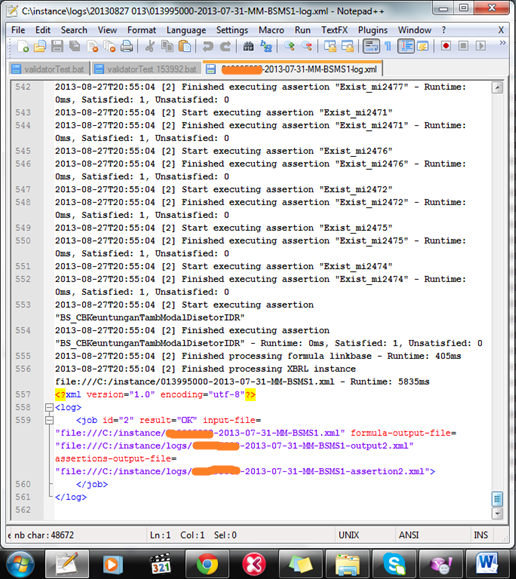
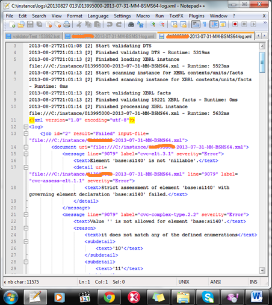
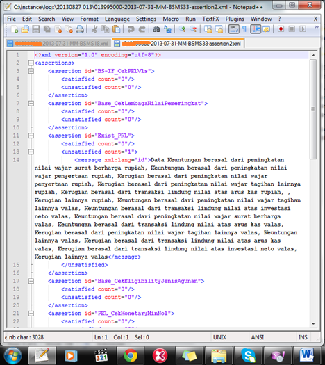

*Originally published on September 9, 2013 at geexbrl.wordpress.com.*

RaptorXML is a products used as XBRL Validator. I will give you a hint how to read validation logs from RaptorXML. But, at first you need to know that RaptorXML produce 4 kinds of logs from every instance documents.

1. **Verbose.txt**
2. **Logs.xml ->** Shows the records of processing an instance document. When a process is started, when a process is stopped, and which process is failed. In the other hands, this file shows you technical errors that occurs in processed instance document.
3. **Assertion.xml ->** Shows the details of every validation rules, which is related to processed instance document. If your data violence a validation in formula linkbase, then you’ll get an “user specified messages” for that rule.
4. **Output.xml ->** Contains some items that define as an output in formula assertion in formula linkbase.

To make your data passes both technical and business rule, you need to be able to read Technical Logs (Log.xml) and Business Logs (assertion.xml). Next, i will use technical logs and business logs terms for the both of logs.

**How To Read Technical Logs**

I will give you an example of technical logs that doesn’t contain any technical error (below).

As captured above, if there is no technical error in your instance, then “log/job/@result” returns an “OK” value. But, when there are technical errors, such as unmatched data type, not nillable value, or unmatched between open tag and close tag (xml errors), etc, the technical logs will become like this.

You can get error message in node “log/job/document/message/text” from technical logs. Every child of that node will explain why is the error occurs and how to solve it. Because, this is technical logs, the terms that is used in message is a little bit hard to be understood by non technical person.

**How To Read Business Logs**

Business logs will not occurs when there is a technical error in technical logs. Message in technical logs is gotten from file specification (XBRL specification and XML specification), but message in business rule is gotten from formula linkbase, which is defined by user. So, either technical or non technical person can understand clearly why is the error occurs and how to solve it. Here is an example of business logs.

There is two type of assertion evaluate in business logs, value assertion and existence assertion. Value assertion check one or more fact match with the value or fact specified in business rule. Existence assertion check if one or more facts exist in processing instance document.

In picture above, “BS-IF_CekPKLVls” is success, because unsatisfied count is “0”. But, Exist_PKL is violate validation rule because unsatisfied count is “more than 0”. The explanation of errors is in “assertions/assertion/unsatisfied/message”.

Beside the error and success condition, there is a “not evaluated” condition. Not evaluated condition occurs when there is no data related to validation rules (assertion): unsatisfied count = 0 and satisfied count = 0.

**TIPS : Use XPath to identify error from technical logs and business logs**

-by Sri Handika Utami
