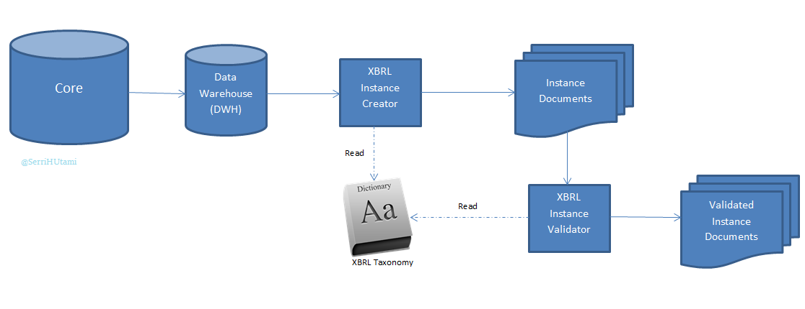

*Originally published on September 30, 2013 at geexbrl.wordpress.com.*

When i discuss about using XBRL as reporting technology, most of reporting entity told me about how expensive the implementation is. Actually, building XBRL Reporting System is not always required a quite amount of money. You need to be careful in deciding what kind of tools will be used.

Before you decide which tools is required for your reporting system. you need to know how instance documents created. Diagram (below) shows you how to create XBRL instance document until it is ready to be reported.

Here are 4 things that you need to create an instance documents:

1. **Good Data Source:** To create a good instance you need the data source that has all the data you need to. The data has to comply with the requirement. (Hint: Creating a rule for stored data will help you to decrease the number of correction process, when violations detect in the next steps)
2. **XBRL Taxonomy:** In taxonomy every tag is defined for individual items of data ([http://xbrl.org/how-xbrl-works-1](http://xbrl.org/how-xbrl-works-1)). XBRL taxonomy is a data dictionary that contains a specific schema for each report. Every single instance documents refers to a related schema in taxonomy. (Hint: Use the same XBRL taxonomy with the reporting system)
3. **XBRL Instance Creator:** Instance creator is tools using to create an instance documents for specific report. XBRL instance creator needs the data source to get fact and taxonomy as guidelines of how the data should report (include data type, rule of data – validation, and the sequence of data). It also needs a mapping to link every data with a related XBRL item. (Hint: a good instance creator need to show you whether your data fulfill the rule specified in taxonomy or not)
4. **XBRL Instance Validator (Optional):** XBRL validator is needed to detect either technical violation (define in schema) or business violation (define in formula linkbase).

When you have a free from violation data source and a good instance creator (can tell you when your data violate technical validation), having an instance validator is only an option. But, if you don’t put a business validation in your data source, then having an instance validator is a must.

In the other hands, there are alternatives for instance creator. You can choose XBRL instance creator tools in the market, or you can using an XML mapper tools (VBA based, java based, etc), or you can use ETL. Every tools have their own pros and cons points.

In choosing your tools, the first thing you need to do is understand your current reporting system. After that, you should identify which component you should reuse and which one need enhancements. Then, put instance creator and validation tools in your process flow.

Identify which process is overlapping, for example, whether business validation in your DWH overlap business validation in your XBRL validator. With this process you will increase efficiency in your reporting process, and also can help you to cut some of your budget :).

But don’t forget, performance is number one. State the key performance before you choose the solutions.

-by Sri Handika Utami
