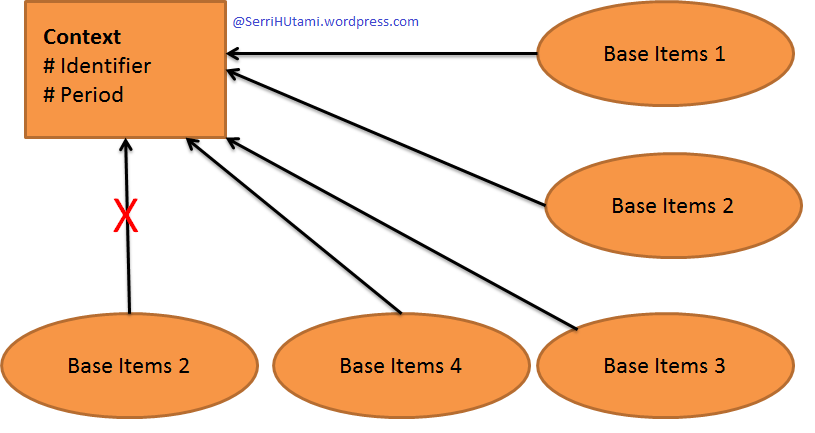
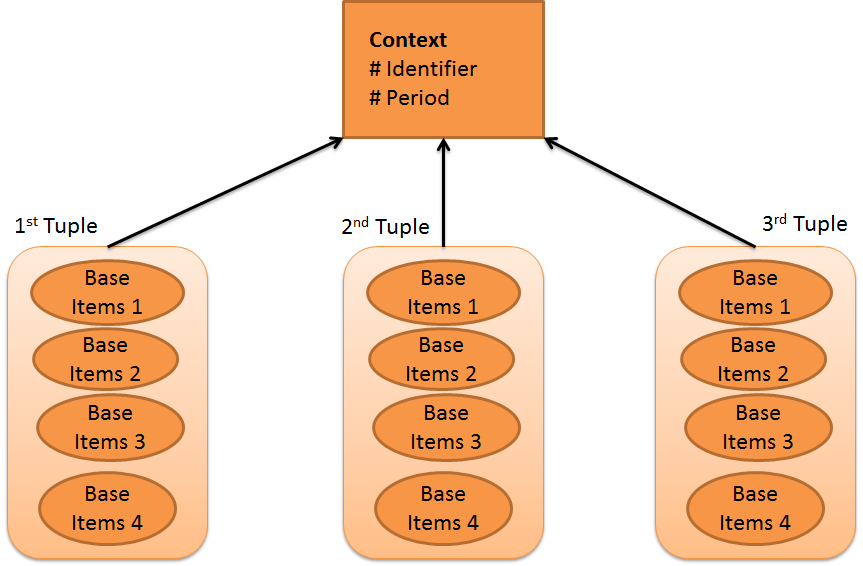
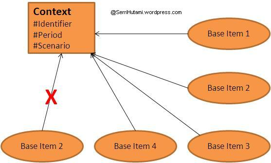

*Originally published on February 12, 2014 at geexbrl.wordpress.com.*

There are 3 types of XBRL architecture: simple, tuple, and dimensional architecture. Instead of using one of that type of architecture, LSMK implement using “The Hybrid” architecture. Hybrid means the taxonomy architecture combine both dimensional and tuple concept. Before i explain why implement with this “new one” architecture, i will explain to you about the three architecture i mentioned.

**1. Simple Architecture**  
In simple architecture, there is no structural rule, such as sequence of items reported, maximum and minimum occurrence of an items in instance documents, etc. Items reported under “” tag. Every items reported as base items, there is no domain member or dimension.

Each items which is reported in simple architecture is unique in the same context. If one items is reported more than one times within a context, then only one of them is recognized.  
Context of this architecture only contents identifier and period of the data.

**2. Tuple Architecture**  
Different with simple architecture, tuple architecture allows more than one occurrence of a base items in a context. Every base items are reported under tuple tags. Tuple has the rule how items should be reported under it, for example whether the items should be reported in sequence or not, maximum and minimum occurrence of each items under it, etc.

**3. Dimensional Architecture**

In Dimensional architecture, context is not only identifier and period. Context in dimensional architecture, later i will called it as “dimensional context”, has the other element called scenario. In this term, Base item put in the point, which is defined by every hypercube-arc (dimension) in scenario. Scenario become a measure for reported base items.

Using this method, the data could be analyzed more easily by slicing and dicing hypercube related.

-by Sri Handika Utami
