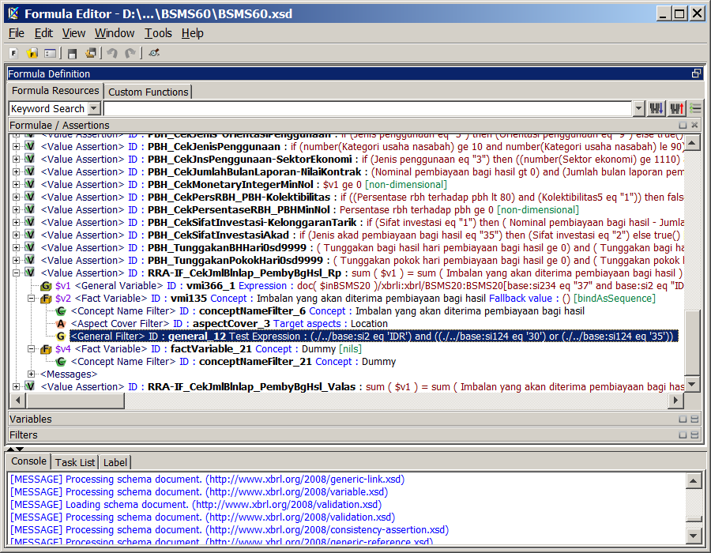
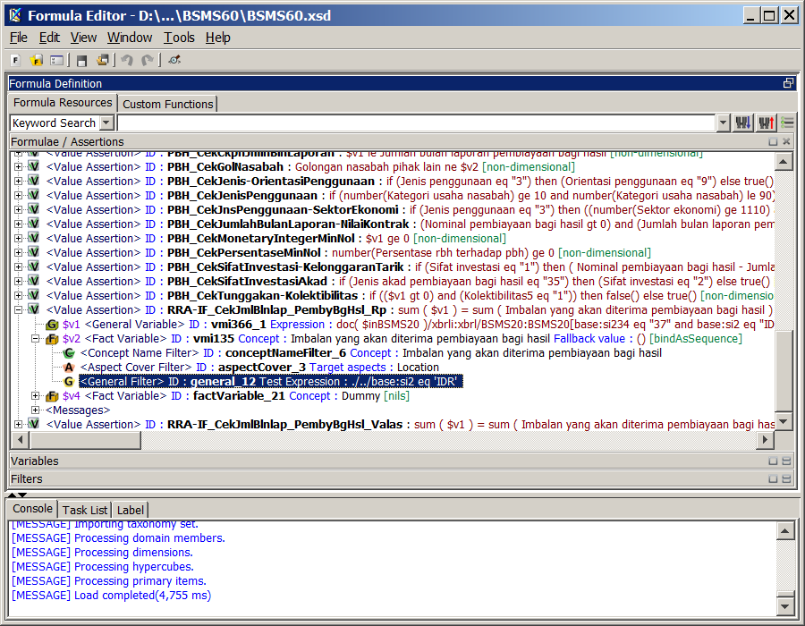

*Originally published on May 14, 2014 at geexbrl.wordpress.com.*

Hello,,, nice to see you again 🙂

Today some of syaria bank on LSMK, complain with form 13 (BSMS60). They have problem about RRA_IF_CekJmlBlnLap_PembyBgHsl_Rp and RRA_IF_CekJmlBlnLap_PembyBgHsl_Valas. They were sure that there is no error in the submitted data, but still they can’t success with this assertion.

The picture below explain about general filter named general_12 refers by two or more fact variable which should not have the same value. That makes the processing value only right for one assertion but is not right for the others.

But on previous version the general filter contains the right expression because the facts which refers to filter should get the same value.

So, to fix it, regulator must change one of this filter into a new filter which has difference expression from before and reupload fixed taxonomy to SRP. After that, syaria bank (as reporting entity) should reupload their report to assure validation success and get the reporting receipt.

-by Gustaf Prameswara
