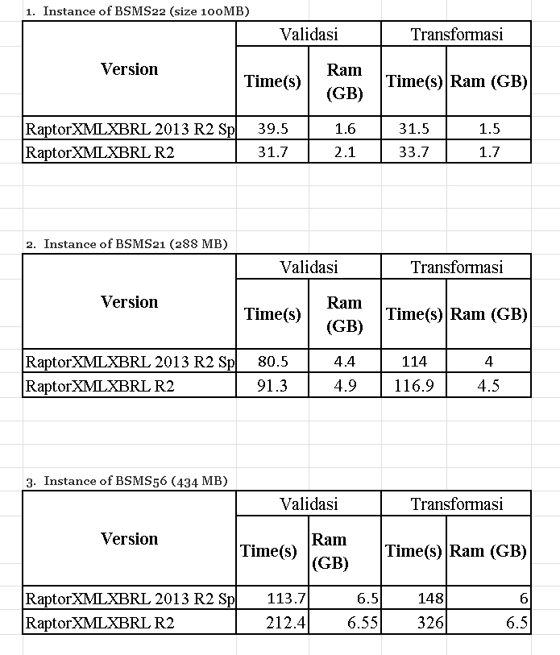

*Originally published on May 14, 2014 at geexbrl.wordpress.com.*

Hello guys,

Altova has been release RaptorXMLXBRL server 2014 R2. So, i try to compare this version with previous version, RaptorXMLXBRL 2013 R2 Sp5.

Testing held using two machines HP EliteBook 8560w with specification below :  
RaptorXMLXBRL server 2014 R2,  
Processor intel i7, with 4 core  
Ram 8 GB  
OS Windows Server 2008 R2

RaptorXMLXBRL 2013 R2 Sp5  
Processor intel i7, with 4 core  
Ram 8 GB  
OS Windows 7 ultimate

For testing performance of validation and transformation process, i use 3 instance documents

We can ignore CPU Average variable, because it is nearly similar.

So far, new version of RaptorXMLXBRL running slower than previous version, for both validation process and transformation process. It looks like, new version took longer time to process big size of instance. But for small instance, they do better than before. It seems that the newer version have bigger exponential variable. That is all i can share to you. Perhaps you can give me some idea about this phenomena 🙂

-Gustaf Prameswara
