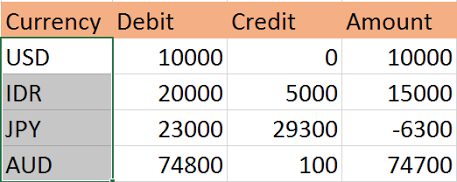

*Originally published on January 19, 2015 at geexbrl.wordpress.com.*

Hi every body, long time no post (again). It’s rainy on Jakarta. Hemn, lets talk about Extensible Enumeration. This is a new specification which have ‘recommendation’ status last year, on October 30, 2014.

Recently, my team is doing some “experiments” with Extensible Enumeration using the latest fujitsu consortium version.

We have a case, that expected to be solved using extensible enumeration, and if extensible enumeration could be the solution, it would be a great progress for our project. The sample of that case is :

- Assuming we have this table for cash details which contains these fields

- Debit, Credit, and Amount are base items
- Currency is a dimension which has its members from domain currency (DCR)
- The question is, can we use extensible enumeration to report Currency, Debit, Credit, and amount in a tuple without using scenario in the context?

Extensible enumeration have solution for this problem. We don’t need to create any dimensional context for this. Point is use of tuple structure has to be clearly controlled. Not like dimension spec, it is pretty easy to create unwanted contents and hard to validate and detect it. Anw, many thanks for Goto-san and team as editors and contributors on this spec.

Anw, right now we are playing with this new specification, wish it can comply our need. If you have any question or any example for this, just let me know 🙂
