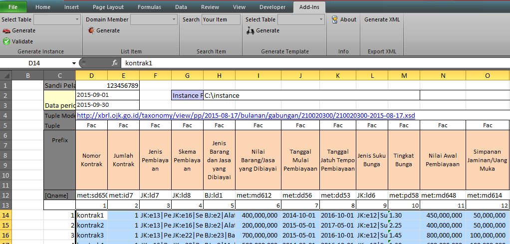
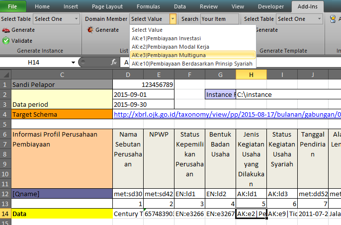

*Originally published on November 30, 2015 at geexbrl.wordpress.com.*

In order to help filler in understanding about how to create report in XBRL format, we have created a Microsoft Excel Add-in to help filler to convert their report into XBRL. This add ins is create to be fit to work with OJK’s Taxonomy. It will work under .NET 4.0 and need MS. Visual Studio tools for Office Runtime 2010.

It will running well under system with at least Windows 7 with microsoft office 2007. And you also need to setup web server (i.e : Internet Information Services (IIS) or apache web server). You need to setup the xbrl.ojk.go.id to local domain.

*The Instance Creator Add-Ins*

This add-ins could help you in create the template with “Generate Template” menu. You could be able to create the input form both for “open table” and “close table”.

This add-ins also support the reference table search by using the “List Item” menu. You will be able to pick one of the reference stated under “extensible enumeration” data type (read [this](/blog/2026/03/28/extensible-enumeration-specification/) for more information). For the extensible enumeration with large member, we also help you with “search item” menu to specified your reference.

The most important feature of this add-ins is the “Generate Instance” menu. With this menu, you could transform your report from excel into XBRL format. For item which under “met” prefix as their id, it means you can type the data as is. There is no table reference for that item. But for item that have other than “met” prefix as id, you should pick the item from table reference.

For validation process, you should use any XBRL validator. Validate button here just for showing possibilities of using excel to call validator and write validator message in excel sheet.

[Download Excel Add-ins](http://www.4shared.com/zip/jNz2Z8k0ce/5_Add-Ins-182.html)
