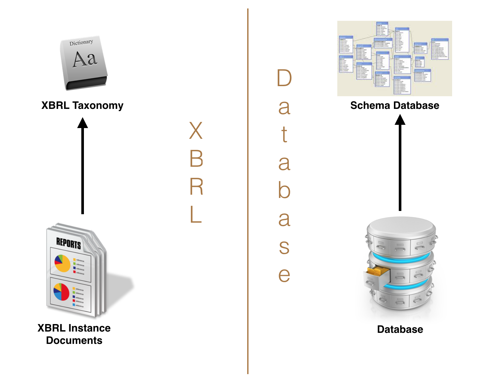

*Originally published on December 16, 2015 at geexbrl.wordpress.com.*

Hi, all. Since there are so many company in Financing (Multi-finance) Industry wondering how to create the database/datamart that could meet very well with the data requirements stated in XBRL Taxonomy. So, before we got to the point how to matches your databases with XBRL instance documents, let me explain how XBRL working on your report. You can also read [my article before](/blog/2026/03/22/xbrl-is-not-always-expensive/).

For summarize, in XBRL reporting, there are several elements that revers or generated by the system:

- XBRL Taxonomy: XBRL taxonomy has the function as the metadata for the reports received. The taxonomy build by this elements in the structure:
  - Schema File (.xsd): Schema file like the centre of the taxonomy structure. The schema has the responsibility to lists all the elements could be reported and all the details regulation to report each elements. The details regulation is stated in the linkbase documents that is listed and linked in schema file.
  - XBRL Linkbases: XBRL linkbase supported the schema file to describe each elements listed on it. Each type of linkbase documents created to stated the specific things for the elements. Here are some linkbases that you will often find in taxonomy.
    - Presentation Linkbase: How the data is presented by the viewing tools.
    - Definition Linkbase: How each elements linked into each other, such as hierarchy (parent-child relationship), containing (domain-member relationship), inclusion and/or exclusion of several members in report.
    - Reference Linkbase: Where each element refers in the standard or other formal documents, to help the subject matter expert on define the data requested.
    - Label Linkbase: How the elements should called. Could stated in several languages and several scope (global and specific).
    - Calculation Linkbase: How the elements calculate from the other.
    - Formula Linkbase: Define validation for each elements in reports.
- XBRL Instance Documents: Report in XBRL/XML format that generated based on XBRL Taxonomy
  - Schema Information: Information about schema reference
  - Reports Context:
    - Identifier: Entity code information
    - Period: Report period
  - Units: Report currency
  - Data: Data reported

*Like A Reflection: XBRL and Database*

The picture above i created to show you about how the XBRL and Database work both with the metadata and the data. So, probably you could also summarize from the picture, the most cleanest way to make your database comply with taxonomy is by created the schema database from the XBRL Taxonomy. You could mapped the schema by using ETL or the other technology that have the similar function. So, your first step is to learn about how the metadata stated in taxonomy and mapped it into the Database Schema.

So, that is a little bit introduction for you to be able to start on creating your fully comply database/datamart with XBRL Taxonomy. Please let me know your opinion or the further question about this.
