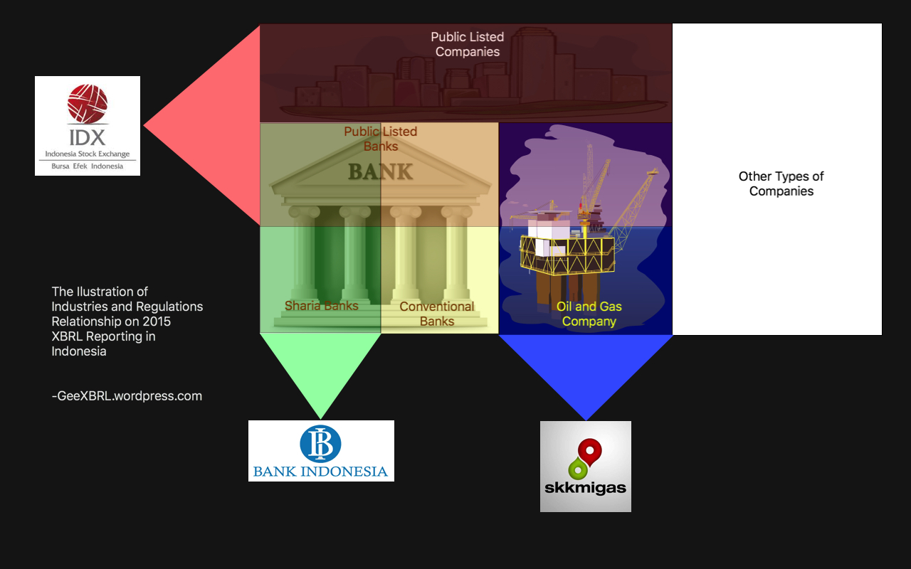
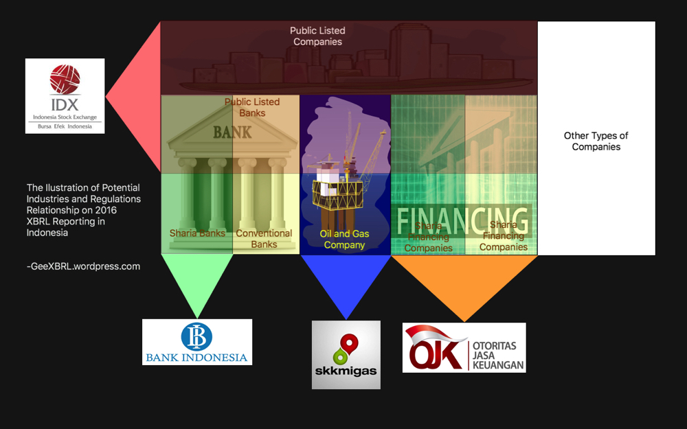

*Originally published on January 20, 2016 at geexbrl.wordpress.com.*

Hi Guys, happy new year. This is our first post in this hopefully very good year. In this post i would be trying my best to be XBRL forecaster, like weather forecaster, for XBRL Projects Status in Indonesia.

Since last year there are three institutions which were already implementing XBRL for the filler under their supervision. They are IDX, Bank Indonesia, and SKK Migas. Here are 2015 stories of them:

- Bank Indonesia: Bank Indonesia already implemented XBRL for the Sharia Bank’s Monthly Reporting (LBUS) since 2013. Since then, Bank Indonesia still working on the next step of XBRL Reporting which will integrated all the reporting from Bank that called Monetary Stability and Financial System Reporting (LSMK). The number of reporting system users in LBUS is almost 600 users. Not only capture the 4 main information in Financial Report (Financial Statement, Profit Lost Statement, Cash Flow, and the statement of changes equity), this report also capture the details data of Credits, securities, funds, and other important details. This details information has the effect on the size of data, but the data is necessary since the details is a needs for Banking Supervisor to investigate and mitigate the Problem in the Fillers.
- IDX: IDX is implemented XBRL for one of it’s reporting component, that called E024 or Financial Report. This implementation including 4 Forms in Financial Report and also the Company Profile Form. The system is already launched in 22nd June, 2015. They are planning to enhance this implementation into some disclosure forms. The industries reporting to this organization is more than 500 companies from all of the industrial sectors.
- SKK Migas: SKK Migas is implemented XBRL GL Reporting, not only for their side but also the work is performed for their fillers sides. Since they need to implemented in their fillers side one by one, the implementation for 2015 is including two oil and gas company. Hopefully next year the number of company reporting using this system is increasing.

The picture above will show you about the fillers and the regulatory institution that already involving in XBRL project 2015.

*2015 XBRL Reporting Illustration in Indonesia*

Beside that three implementation in Indonesia, in 2016 OJK will be implemented XBRL Integrated Reporting for Financing Company Reporting and Sharia Financing Company Reporting. Last year this project still in development stage, but if everything is going as they planned, on the early of this year they will launch this project. Since the OJK responsibility is to perform the supervisory and surveillance activity to control all Financial Institution in Indonesia, like Bank Indonesia they also need the details data from their filler.

The size of the report they will receive will be huge, since they need to handle more than 200 Company as the fillers from Sharia Financing Company and Financing Company. Beside that, they are also take the other steps to integrate the other types of company reporting system under the same framework and system. If they succeed on executing this huge project, all the financial company in Indonesia will be reporting using XBRL System.

The picture below will be show you what the industry is hopefully involving in XBRL on 2016.

*2016 Potential XBRL Reporting Maps in Indonesia*

Beside the four regulatory shown in picture above, i estimated that there is the other organization that planning on developing their reporting system using XBRL but the possibility still do not clear yet. Let’s wait and see what will be happening in this hopefully lovely year.
